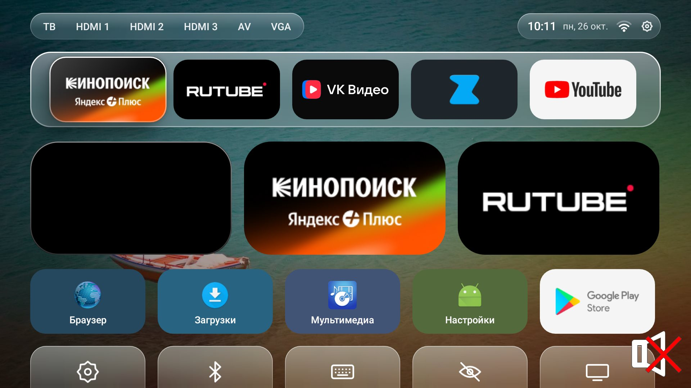

# Polarline 50PU52TC-SM / 58PU55STC-SM: fast launcher and tune-up

[Русский](README.md)

> **Use at your own risk.** The author accepts no responsibility for any consequences: bricked devices, lost data, voided warranty or anything else. The scripts change system settings and the `/system` partition.

For TVs on the TP.MT5522S.PC822 chassis (CVTE, firmware `cvt_mt5886_eu_1g`, Android 7.0, 1 GB RAM). What you get:

- **TV Home launcher**: ~20 MB RAM instead of 45–75 MB for the stock one, 0% CPU when idle, no ad tiles. TV/HDMI inputs with live preview, remote buttons work as with the stock launcher.
- **RUTUBE and VK Video work**: root CAs missing from Android 7.0 are added to the system store.
- **Faster app start**: apps are precompiled. КиноПоиск starts 15–20% faster, RUTUBE 30% faster.
- **More free memory**: AirPlay/EShare/DLNA receivers, vendor stores and ads, boot-time wakeups of КиноПоиск and YouTube are disabled. Idle free memory ~450 MB instead of ~400.
- **RUTUBE search works**: LeanKey keyboard instead of the stock one.
- Animations and location are off.

## Install

1. On the TV: Settings → About → press "Build number" 7 times → Developer options → enable USB debugging. The service menu (Menu → 1147) does not work for this: the authorization prompt never appears. If About is not reachable, install Activity Launcher from Google Play and open `com.android.settings` → Developer options through it.
2. Find the TV's IP (Settings → Network). The PC must be on the same network, with any VPN off.
3. Download this repository (Code → Download ZIP) and run:
   - Windows: `powershell -ExecutionPolicy Bypass -File scripts\install.ps1 -Tv 192.168.1.50`
   - Linux/macOS: `scripts/install.sh 192.168.1.50`
4. On the first connection confirm "Allow USB debugging" on the TV ("Always allow"). The script downloads adb and LeanKey, installs everything and reboots the TV. It takes 10–15 minutes.

Options: `-NoRoot` (no CAs and root tweaks), `-NoLauncher`, `-NoKeyboard`; for `install.sh`: `--no-root`, `--no-launcher`, `--no-keyboard`.

**Undo:** the same script with `-Revert` (`--revert`). To restore only the stock launcher: `adb shell cmd package set-home-activity com.cvte.tv.launcher.fall/com.cvte.tv.launcher.NebulaFallActivity`.

## Launcher

- Menu or long OK on a tile: move, add to/remove from favorites, hide, uninstall.
- The row of large cards shows the TV and recently launched apps. At the end of the grid: Settings, Bluetooth, keyboard picker, hidden apps, stock launcher.
- A different wallpaper every day. "Wifi display" is hidden: starting it drops Wi‑Fi for about 2 minutes.
- Sources and build: [launcher/](launcher/README.en.md).

## Important

- Never disable `com.example.user.myapplication`: it is FallbackHome, and without it the TV hangs on the boot logo.
- Never run `adb reboot bootloader`: the only way out is reflashing.
- Updating an app from Play Market resets its precompilation. Run the script again or `adb shell cmd package compile -m speed -f <package>`.
- The TV unmutes itself on every reboot; if it was muted, the script mutes it again.
- The Wi‑Fi module is weak: if the connection drops, put the router on channel 6 or use a cable.

The scripts are built from commands verified on a 58PU55STC-SM but have not been run end-to-end on a fresh TV. Report problems in [Issues](../../issues).

Details: [docs/notes.en.md](docs/notes.en.md) (measurements, causes), [AGENTS.md](AGENTS.md) (for AI agents), [docs/alice-plan.en.md](docs/alice-plan.en.md) (plan: play a film on the TV by voice via Alice). MIT license.
