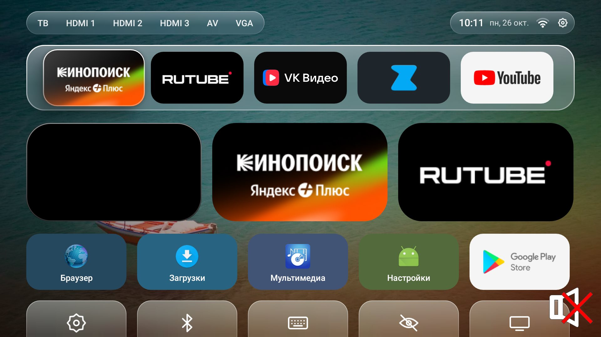

# Polarline 50PU52TC-SM / 58PU55STC-SM: быстрый лаунчер и оптимизация

[English](README.en.md)

> **Всё делаете на свой страх и риск.** Автор не несёт ответственности ни за какие последствия: поломку, потерю данных, гарантии и прочее. Скрипты меняют системные настройки и раздел `/system`.

Телевизоры на шасси TP.MT5522S.PC822 (CVTE, прошивка `cvt_mt5886_eu_1g`, Android 7.0, 1 ГБ RAM). Что даёт:

- **Свой лаунчер TV Home** (~20 МБ RAM вместо 45–75 МБ у родного, 0% CPU в простое), без рекламных плиток. Входы ТВ/HDMI с живым превью, кнопки пульта работают как в родном.
- **Работают RUTUBE и VK Видео:** в системе добавлены корневые сертификаты, которых нет в Android 7.0.
- **Быстрее запуск:** приложения предкомпилированы, КиноПоиск запускается на 15–20% быстрее, RUTUBE — на 30%.
- **Больше свободной памяти:** отключены AirPlay/EShare/DLNA, магазины и реклама производителя, фоновые пробуждения КиноПоиска и YouTube. Свободной памяти в простое ~450 МБ вместо ~400.
- **Работает поиск в RUTUBE:** клавиатура LeanKey вместо штатной.
- Анимации и геолокация выключены.

## Установка

1. На ТВ: «Настройки» → «Об устройстве» → 7 раз «Номер сборки» → «Для разработчиков» → включить «Отладку по USB». Сервисное меню (Menu → 1147) не подходит: окно подтверждения не появится. Если меню «Об устройстве» не открывается, поставьте из Google Play Activity Launcher и откройте через него `com.android.settings` → «Для разработчиков».
2. Узнайте IP телевизора («Настройки» → «Сеть»). ПК должен быть в той же сети, VPN на ПК выключен.
3. Скачайте репозиторий (Code → Download ZIP) и запустите:
   - Windows: `powershell -ExecutionPolicy Bypass -File scripts\install.ps1 -Tv 192.168.1.50`
   - Linux/macOS: `scripts/install.sh 192.168.1.50`
4. При первом подключении подтвердите на ТВ «Разрешить отладку» («Всегда разрешать»). Скрипт сам скачает adb и LeanKey, всё установит и перезагрузит ТВ. Это занимает 10–15 минут.

Параметры: `-NoRoot` (без сертификатов и root-настроек), `-NoLauncher`, `-NoKeyboard`; для `install.sh`: `--no-root`, `--no-launcher`, `--no-keyboard`.

**Откат:** тот же скрипт с `-Revert` (`--revert`). Вернуть только родной лаунчер: `adb shell cmd package set-home-activity com.cvte.tv.launcher.fall/com.cvte.tv.launcher.NebulaFallActivity`.

## Лаунчер

- «Меню» или долгое OK на плитке: переставить, добавить/убрать из избранного, скрыть, удалить.
- Ряд крупных карточек — ТВ и последние запущенные приложения. В конце сетки — Настройки, Bluetooth, выбор клавиатуры, скрытые приложения, родной лаунчер.
- Обои меняются каждый день. «Wifi дисплей» скрыт: его запуск рвёт Wi‑Fi примерно на 2 минуты.
- Исходники и сборка — [launcher/](launcher/README.md).

## Важно

- Не отключайте `com.example.user.myapplication`: это FallbackHome, без него ТВ зависает на логотипе.
- Не выполняйте `adb reboot bootloader`: выйти оттуда можно только перепрошивкой.
- После обновления приложения из Play Market его компиляция сбрасывается. Запустите скрипт ещё раз или выполните `adb shell cmd package compile -m speed -f <пакет>`.
- После каждой перезагрузки ТВ сам снимает «без звука». Если звук был выключен, скрипт выключает его снова.
- Wi‑Fi модуль слабый: если связь рвётся, поставьте роутер на канал 6 или подключите кабель.

Скрипты собраны из команд, проверенных на 58PU55STC-SM, но целиком на «чистом» ТВ не прогонялись. О проблемах пишите в [Issues](../../issues).

Подробности: [docs/notes.md](docs/notes.md) (замеры, причины), [AGENTS.md](AGENTS.md) (для ИИ-агентов). Лицензия MIT.

## Источники и дополнительные сведения

Ниже собраны сторонние проекты, технические материалы, обсуждения и архивы прошивок для Polarline 50PU52TC-SM / 58PU55STC-SM и близких Android TV платформ.

### Проекты с открытым исходным кодом

1. **[NewPipe](https://github.com/TeamNewPipe/NewPipe)** — Android-видеоплеер. В [Issue #6024](https://github.com/TeamNewPipe/NewPipe/issues/6024) описана проблема черного экрана при воспроизведении на платформе `cvt_mt5886_eu_1g`. В версии 0.21.2 добавлено отключение media tunneling для этого устройства. [Пример кода DeviceUtils.java](https://git.osmarks.net/mirrors/NewPipe/src/commit/26dd86e967ce2b2439cfaf653f5380c2871e3724/app/src/main/java/org/schabi/newpipe/util/DeviceUtils.java). **Особенно полезно:** точное совпадение идентификатора платформы с данным проектом.

2. **[Luncher](https://github.com/CVasilakis/luncher)** — минималистичный лаунчер Android TV без лишних разрешений и зависимостей. Полезен для сравнения архитектуры, потребления памяти и производительности с TV Home.

3. **[LtvLauncher](https://github.com/leanbitlab-org/LtvLauncher)** — модификация FLauncher с дополнительными возможностями интерфейса. Интересен реализацией навигации пультом, организации приложений и пользовательских элементов интерфейса.

4. **[LeanKeyboard](https://github.com/yuliskov/LeanKeyboard)** — открытая клавиатура для Android TV. Источник для изучения работы с D-pad, методами ввода и совместимости с приложениями на старых версиях Android.

5. **[Universal Android Debloater NG](https://github.com/Universal-Debloater-Alliance/universal-android-debloater-next-generation)** — инструмент управления системными пакетами Android через ADB без root. Полезен для анализа и отключения ненужных приложений. Списки пакетов не следует применять к Polarline без индивидуальной проверки.

### Прошивки, дампы и аппаратная документация

6. **[Forum Monitor — Polarline 58PU55STC-SM](https://forum-monitor.net.ru/pages/file_upload/22109/)** — USB-прошивка для модели 58PU55STC-SM, шасси TP.MT5522S.PC822. Сведения о совместимости аппаратной ревизии и панели.

7. **[Remont-Aud — Polarline 58PU55STC-SM](https://remont-aud.net/dump/lcd_pdp_tv/prochee/polarline_58pu55stc_sm_shassi_main_board_tp_mt5522s_pc822/248-1-0-134123)** — материалы по дампу eMMC и USB-прошивке. Указаны компоненты платы MT5522ZH0J и KLM8G1GETF-B041. Полезно при исследовании вариантов аппаратного восстановления. Дамп не подтвержден повторной успешной прошивкой.

8. **[KenotronTV — Polarline 50PU52TC-SM](https://kenotrontv.ru/files/file/8081-polarline-50pu52tc-sm-mtk5522spc822-cc500pv1d-usb-po/)** — USB-прошивка для платы MTK5522S.PC822 с матрицей CC500PV1D.

9. **[KLIKCloud — архив Polarline](https://klikcloud.ru/ru/folders/30450-polarline)** — каталог прошивок телевизоров Polarline. Полезен для поиска разных вариантов ПО и аппаратных конфигураций, включая отличающиеся матрицы одной модели.

### Форумы и обсуждения

10. **[4PDA — обсуждение Polarline](https://4pda.to/forum/index.php?showtopic=980343)** — обсуждения моделей, прошивок, инженерного меню, работы HDMI и практического опыта эксплуатации.

### Важные замечания

- Совпадение маркировки шасси не означает полной совместимости прошивок. Проверяйте модель матрицы, ревизию платы, конфигурацию памяти и версию ПО.
- Сторонние прошивки и дампы перечислены как справочные материалы, а не рекомендованные к установке.
- Совместимость перечисленных приложений и инструментов с Android 7.0 и конкретными моделями Polarline не гарантируется.
- Открытие страницы источника не подтверждает доступность, целостность или безопасность размещенных на ней файлов.
